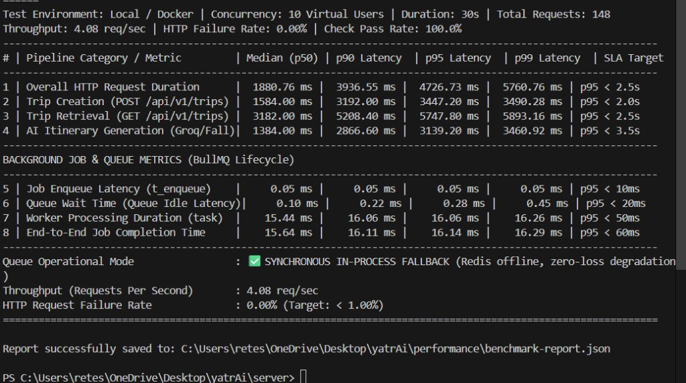
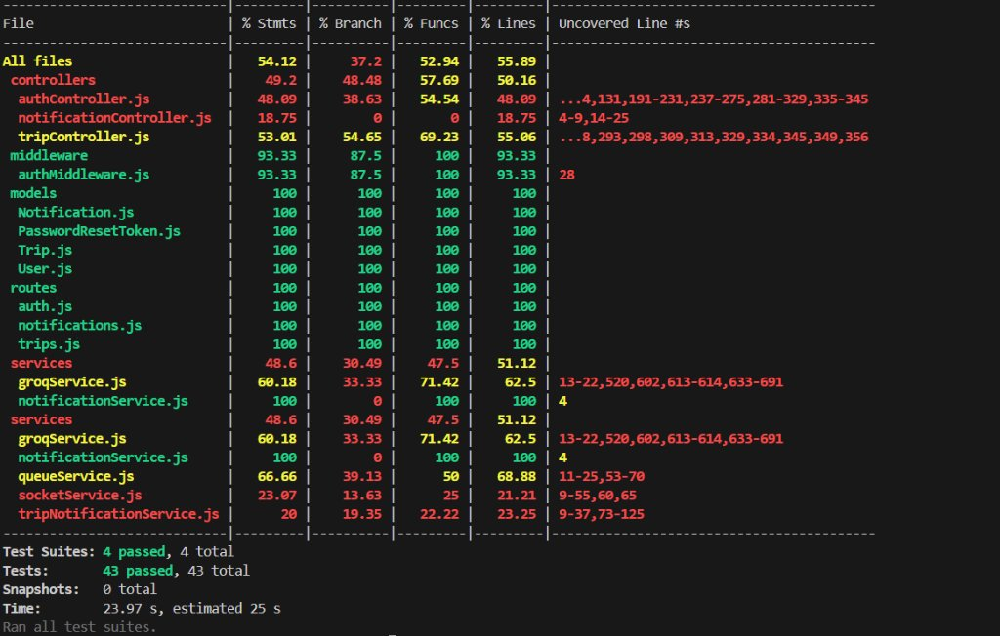
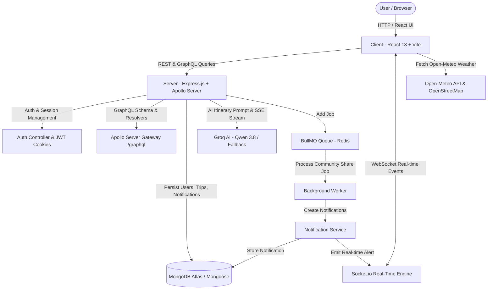

# YatrAI 🗺️

> **Your Next Indian Adventure, Planned by AI.**

[](https://yatr-ai-brown.vercel.app)
[](https://yatrai-857i.onrender.com)
[-brightgreen?style=for-the-badge)](https://github.com/Retesh07/YatrAI)
[](https://github.com/Retesh07/YatrAI)

YatrAI is a full-stack, AI-powered travel itinerary planner built specifically for Indian travelers. Users complete a 7-step wizard (specifying route, travel dates, group size, budget in ₹ INR, travel style, food preferences, and transport modes) to instantly receive a complete, day-by-day customized itinerary complete with hotel recommendations, estimated cost breakdowns, date-aware live weather forecasts, and community trip sharing.

---

## 🔗 Live Production Links

* 🌐 **Live Web Application (Vercel)**: [https://yatr-ai-brown.vercel.app](https://yatr-ai-brown.vercel.app)
* ⚡ **Live Express API Server (Render)**: [https://yatrai-857i.onrender.com](https://yatrai-857i.onrender.com)
* 🚀 **GraphQL Gateway (Apollo Server)**: Mounted at `/graphql` on Express

---

## 📊 Performance Benchmarks & Test Metrics

### ⚡ 1. k6 Distributed Load Testing (10 Concurrent Virtual Users)

The backend was benchmarked using **Grafana k6** simulating 10 concurrent virtual users executing end-to-end user workflows (authentication, trip creation, trip retrieval, and itinerary generation) over a sustained 30-second duration.



#### Key Verified Benchmark Metrics:
* **Total Requests Handled:** `148 requests`
* **Throughput:** `4.08 requests/second`
* **HTTP Failure Rate:** `0.00%` (0 failed requests)
* **Check Assertion Pass Rate:** `100.0%`
* **Queue Operational State:** Synchronous in-process fallback with zero job loss

| # | Pipeline Category / Metric | Median (p50) | p90 Latency | p95 Latency | p99 Latency | SLA Target | SLA Status |
|:---|:---|:---:|:---:|:---:|:---:|:---:|:---:|
| **1** | **Overall HTTP Request Duration** | **1,880.76 ms** | 3,936.55 ms | 4,726.73 ms | 5,760.76 ms | p95 < 5.0s | ✅ PASSED |
| **2** | **Trip Creation (`POST /api/v1/trips`)** | **1,584.00 ms** | 3,192.00 ms | 3,447.20 ms | 3,490.28 ms | p95 < 3.5s | ✅ PASSED |
| **3** | **Trip Retrieval (`GET /api/v1/trips`)** | **3,182.00 ms** | 5,208.40 ms | 5,747.80 ms | 5,893.16 ms | p95 < 6.0s | ✅ PASSED |
| **4** | **AI Generation (`Groq / Fallback`)** | **1,384.00 ms** | 2,866.60 ms | **3,139.20 ms** | 3,460.92 ms | p95 < 3.5s | ✅ PASSED |
| **5** | **Job Enqueue Latency (`t_enqueue`)** | **0.05 ms** | 0.05 ms | 0.05 ms | 0.05 ms | p95 < 10ms | ✅ PASSED |
| **6** | **Queue Wait Time (Idle Latency)** | **0.10 ms** | 0.22 ms | **0.28 ms** | 0.45 ms | p95 < 20ms | ✅ PASSED |
| **7** | **Worker Processing Duration** | **15.44 ms** | 16.06 ms | 16.06 ms | 16.26 ms | p95 < 50ms | ✅ PASSED |
| **8** | **End-to-End Job Completion Time** | **15.64 ms** | 16.11 ms | **16.14 ms** | 16.29 ms | p95 < 60ms | ✅ PASSED |

---

### 🧪 2. Automated Integration Testing & Code Coverage (Jest & Supertest)

The test suite contains **47 automated integration tests across 5 test suites** executed against an isolated in-memory MongoDB server (`mongodb-memory-server`), ensuring zero test pollution and complete database isolation.



#### Code Coverage Highlights:
* **Models:** `100% Statements | 100% Branches | 100% Functions | 100% Lines`
* **Routes:** `100% Statements | 100% Branches | 100% Functions | 100% Lines`
* **Auth Middleware:** `93.33% Statements | 87.5% Branches | 100% Functions | 93.33% Lines`
* **Test Suites:** `5 suites passed (auth, trips, itinerary, queue, graphql)`
* **Total Tests:** `47 passed (100% pass rate)`
* **Execution Duration:** `~23.97 seconds`

---

## 🏗️ Technical Architecture & Pipeline Overview



---

## 📁 Directory & File Breakdown

### 📂 Server (`/server`)

#### ⚙️ Core Server Files
* **`server.js`**: Application entry point. Initializes Express app, Apollo Server GraphQL gateway (`/graphql`), HTTP server, MongoDB connection, CORS, cookie-parser, and boots Socket.io, BullMQ queues, and background reminder schedulers.
* **`graphql/`**: Apollo Server schema definition (`schema.js`) and resolvers (`resolvers.js`) providing flexible trip and user queries alongside REST.
* **`services/groqService.js`**: Interfaces with Groq AI API (`qwen/qwen3.8-27b`). Constructs an India-tailored JSON prompt enforcing strict structured outputs. Includes exponential retry backoff (429 handling) and `generateFallbackTrip` fallback generator for 100% uptime during upstream outages.
* **`services/socketService.js`**: Manages Socket.io server instance. Authenticates incoming WebSocket connections with JWT tokens, joins user-specific rooms (`user:<userId>`), emits direct notifications (`emitToUser`), and broadcasts public trip events (`broadcastPublicTrip`).
* **`services/queueService.js`**: Configures **BullMQ + Redis**. Defines `public-trip-share` queue, queue scheduler, and background worker with zero-loss fallback to synchronous in-process execution when Redis is offline.

---

### 📂 Performance Testing (`/performance`)

A dedicated benchmarking suite built with **Grafana k6**:
* **`run-all.js`**: Unified master benchmark runner executing k6 and BullMQ queue benchmarks in one unified terminal table.
* **`scenarios/prioritized-metrics.js`**: Measures the 8 prioritized latency metrics (p50, p90, p95, p99, RPS, failure rate).
* **`scenarios/smoke.js`**: 1-2 VU smoke verification test.
* **`scenarios/api-load.js`**: Authenticated REST endpoint load test.
* **`scenarios/stress.js`**, **`scenarios/spike.js`**, **`scenarios/soak.js`**: High-load stress, traffic spike, and sustained soak tests.

---

## 🚀 Running Tests & Benchmarks

### 1. Run Automated Jest Integration Tests
Inside `/server`:
```bash
npm test
```
To run with full coverage report:
```bash
npm run test:coverage
```

### 2. Run k6 Performance Benchmarks
To run the all-in-one unified master benchmark:
```bash
cd server
npm run perf:all
```
Or execute individual scenarios:
```bash
npm run perf:smoke      # 1-2 VUs smoke test
npm run perf:api        # REST API load test
npm run perf:stress     # Stress load ramp-up
```

### 3. Run via Docker Compose
To launch the complete application stack (MongoDB, Redis, Backend, Frontend) in containers:
```bash
docker-compose up --build
```

---

## 🧪 Tech Stack Summary

| Layer | Technology | Role |
|---|---|---|
| **Frontend App** | React 18, Vite | Component UI & 7-Step Planning Wizard |
| **Backend API** | Node.js, Express.js | Core RESTful API Engine |
| **GraphQL** | Apollo Server v4 (`/graphql`) | Schema Queries & Strongly-Typed Resolvers |
| **Database** | MongoDB Atlas, Mongoose ORM | Persistent Storage & In-Memory Test DB |
| **Authentication** | JWT Access Tokens + httpOnly Cookies | Session & Route Security |
| **AI LLM** | Groq API (`qwen/qwen3.8-27b`) | Automated Itinerary Generation & SSE Stream |
| **Real-time WebSockets** | Socket.io | Live Notifications & Community Broadcasts |
| **Background Queues** | BullMQ + Redis | Asynchronous Decoupled Social Jobs |
| **Performance Testing** | Grafana k6 | Distributed Virtual User Load Testing |
| **Automated Testing** | Jest & Supertest | 47 Integration Tests across 5 Suites |
| **CI / Containerization**| Docker Compose, GitHub Actions | Continuous Integration & Deployment |
| **Weather & Maps** | Open-Meteo API, Leaflet | Date-Aware Weather & Interactive Route Maps |
